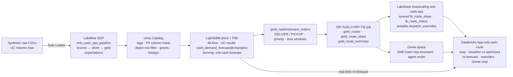

# SNB Cash Logistics — forecast-driven cash-in-transit routing on Databricks

> **All data is synthetic.** Siam Northeast Bank (SNB) is a **fictional** bank. No real bank, customer, branch code or transaction appears in this repository. Every KPI below is a result from a synthetic-data demo, not a customer result.

Siam Northeast Bank runs 159 branches and 520 machines (400 ATMs + 120 cash-recycling machines, RCMs) from 3 cash centres in Khon Kaen, Northeast Thailand, with 30 cash-in-transit (CIT) vans. Every node is replenished on a **fixed 5-day cycle**. The result: wasted stops at machines that are still full, **cash-outs** when payday or holidays empty ATMs early, and **idle cash** parked in cassettes and vaults.

This build replaces the calendar with **demand**: forecast every node's cash need, generate replenishment orders, and solve tomorrow's routes. Dispatchers get the plan, a map and a natural-language assistant in one Databricks App.

## Outcome (synthetic-data demo, plan date 2026-10-01)

| Buyer KPI | Fixed 5-day cycle | Forecast + optimizer | Change |
|---|---|---|---|
| CIT cost per day (THB) | 75,400 | 69,550 | −8% |
| Vans dispatched | 11 | 13 | |
| Route km | | | −23% |
| Cash-out risk nodes | 64 | 0 | |
| Idle cash released (THB) | | 43M | |
| Time-window SLA | | 100% | |
| Forecast WAPE (lower is better) | naive 39% | model 25% | |

**Indicative annual CIT saving: THB 1.5M.** The numbers come from `gold_route_summary` and `gold_model_metrics` and are logged in `evidence/`.

## Architecture



Each stage reads the previous stage's governed output; nothing is copied out of Unity Catalog. Compute is serverless throughout.

| Stage | Databricks capability | What it does here |
|---|---|---|
| Ingest | Lakeflow Spark Declarative Pipelines, Auto Loader | 8 raw feeds → bronze → silver (typed, `expect_or_drop` / `expect`) → gold |
| Govern | Unity Catalog | Layer/domain/PII tags, custodian column mask, depot row filter, gold-only grants, lineage |
| Intelligence | MLflow, UC Model Registry, Model Serving, OR-Tools | Global LightGBM demand forecast (point + P80), replenishment orders, CVRP-TW routes |
| Operational serving | Lakebase Autoscaling | Synced route/node tables for millisecond reads; writable dispatch overrides |
| Natural language | Genie space (agent mode) | Cash Ops asks questions over governed gold tables |
| Business surface | Databricks Apps (React + FastAPI) | Map, KPIs, baseline vs optimized, re-forecast, overrides, Genie chat |

## Repository layout

| Path | Contents | Owner |
|---|---|---|
| `contract/` | Frozen naming (`naming.md`) and table contract (`tables.yaml`) | lead |
| `databricks.yml`, `resources/` | Asset Bundle, pipeline and end-to-end job `snb_cash_ops_e2e` | lead / data |
| `brand/` | SNB logo and colours | lead |
| `data/` | Synthetic data generator notebook | data |
| `pipelines/` | Lakeflow SDP pipeline `snb_cash_ops_pipeline` | data |
| `governance/` | UC tags, mask, row filter, grants | data |
| `ml/` | Train/register, serving endpoint, scoring + orders, OR-Tools optimizer | ml |
| `lakebase/` | Lakebase project, synced tables, `dispatch_overrides` | lakebase |
| `genie/` | Genie space definition, instructions, benchmark questions | genie |
| `app/` | Databricks App `snb-cash-route` (React frontend, FastAPI server) | app |
| `evidence/` | Text evidence that the build ran (run outputs, query results, model output) | all agents / integrator |
| `deck/` | Business deck (`deck.md`, `deck.pdf`), build script, KPI placeholders | narrative |
| `docs/` | Decisions, demo script, role-play prep, submission answers, requirements traceability | narrative |

## Deploy and run

Prerequisites: Databricks CLI ≥ 0.250 authenticated as profile `nan-demo` (workspace `https://fevm-stable-classic-nan-fe-vm.cloud.databricks.com`), catalog `stable_classic_nan_fe_vm_catalog`, schema `snb_cash_ops`.

```bash
# 1. Validate and deploy the bundle (pipeline + job)
databricks bundle validate -t dev -p nan-demo
databricks bundle deploy   -t dev -p nan-demo

# 2. Run the whole journey: generate data → Lakeflow → governance → train → serve → score → optimize → Lakebase → Genie
databricks bundle run snb_cash_ops_e2e -t dev -p nan-demo

# 3. Deploy the app (after the job has created the endpoint, Lakebase project and Genie space)
databricks sync ./app /Workspace/Users/<you>/snb-cash-route -p nan-demo
databricks apps create snb-cash-route -p nan-demo          # first time only
databricks apps deploy snb-cash-route \
  --source-code-path /Workspace/Users/<you>/snb-cash-route -p nan-demo
```

Then grant the app's service principal `SELECT` on the gold tables, `CAN_QUERY` on `snb-cash-forecast`, access to the Genie space and the Lakebase role (see `app/` and `lakebase/` for the exact commands).

End-to-end job tasks: `generate_data` → `lakeflow_pipeline` → `governance` + `train_register` → `deploy_endpoint` → `score_orders` → `optimize_routes` → `lakebase_sync` + `genie_space`.

## Evidence that it ran

The evaluator reads text, so every stage commits its run output to `evidence/`:

| Stage | Evidence file |
|---|---|
| Synthetic data + Lakeflow pipeline (row counts, expectation results) | `evidence/data_*.txt` |
| Unity Catalog governance (tags, mask, row filter, grants) | `evidence/data_governance*.txt` |
| Model training metrics, registry, serving response | `evidence/ml_*.txt` |
| Replenishment orders, routes, baseline vs optimized summary | `evidence/ml_route_summary*.txt` |
| Lakebase synced tables + overrides round trip | `evidence/lakebase_*.txt` |
| Genie space + benchmark answers | `evidence/genie_*.txt` |
| App health and API responses | `evidence/app_*.txt` |
| End-to-end job run | `evidence/e2e_*.txt` |

## Decisions and trade-offs

Short version (full rationale in [`docs/decisions.md`](docs/decisions.md)):

- **Declarative pipelines over notebooks** for ingest: expectations, lineage and incremental loading come built in.
- **One global LightGBM** over 679 per-node models: shares payday/holiday signal and forecasts new machines.
- **P80 quantile** for replenishment: a cash-out costs more than a little extra cash.
- **OR-Tools CVRP-TW, 25 s per depot**: explainable and free; not provably optimal.
- **Lakebase synced tables + writable overrides** instead of the app querying the warehouse: millisecond reads and a real write path.
- **Genie agent mode** instead of a custom agent: governed by Unity Catalog and fast to value.
- **Serverless everywhere**: scale-to-zero suits a once-a-day plan; the cost is cold starts.

## AI tools and workflow

Built with Cursor agents working in parallel against a frozen contract (`contract/naming.md`, `contract/tables.yaml`): a lead agent owned the bundle and contract; data, ML, Lakebase, Genie, app and narrative agents each wrote only to their own folder. The contract let stages integrate without waiting on each other; each agent committed its run output to `evidence/`. Design decisions, the industry framing and the narrative were directed and reviewed by the author.

## More

- Business deck: [`deck/deck.pdf`](deck/deck.pdf) (source [`deck/deck.md`](deck/deck.md))
- Demo script: [`docs/demo_script.md`](docs/demo_script.md)
- Role-play prep: [`docs/roleplay_prep.md`](docs/roleplay_prep.md)
- Requirements traceability: [`docs/requirements_traceability.md`](docs/requirements_traceability.md)

---

*Disclaimer: Siam Northeast Bank is fictional. All data is synthetic and generated by `data/01_generate_data.py`. Results show what the approach does on synthetic data and are not a forecast of any real bank's results.*
