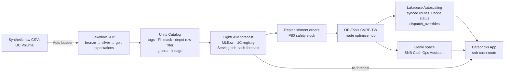

<!-- _class: lead -->

# Zero empty ATMs, shorter routes
## Forecast-driven cash-in-transit routing for Siam Northeast Bank

**−8% CIT cost per day · cash-out risk 64 → 0 nodes · THB 1.5M a year**

Khon Kaen, Northeast Thailand · 159 branches · 520 machines · 3 cash centres · 30 vans

Siam Northeast Bank (SNB) is a fictional bank. All data is synthetic; every figure in this deck is a synthetic-data demo result, not a customer result.

---

<!-- _class: dense -->

## The outcome, in the buyer's KPIs

**Indicative annual CIT saving: THB 1.5M**, before idle-cash carry cost or avoided cash-outs. Fixed 5-day cycle vs demand-driven plan, same estate, **1 Oct 2026** (synthetic plan day).

| Buyer KPI | Fixed 5-day cycle | Forecast + optimizer | Change |
|---|---:|---:|---:|
| **CIT cost / day (THB)** | 75,400 | 69,550 | **−8%** |
| **Vans dispatched** | 11 | 13 | +2 crews to hit SLA |
| **Route km** | | | **−23%** |
| **Cash-out risk nodes** | 64 | 0 | visited in time |
| **Idle cash released (THB)** | | 43M | float freed |
| **Time-window SLA** | | 100% | inside opening hours |
| **Forecast WAPE** | naive 39% | model 25% | better signal |

---

## The problem: a calendar, not demand, decides where cash goes

SNB replenishes every branch, ATM and cash-recycling machine (RCM) on a **fixed 5-day cycle**.

| Symptom | What it costs SNB |
|---|---|
| **Wasted stops**: vans visit machines that are still mostly full, because "it's day 5" | Fuel, armed-crew hours, vehicle wear |
| **Cash-outs**: payday and holiday spikes empty ATMs before the next visit | Lost fees, branch queues, complaints, brand damage in rural districts |
| **Idle cash**: cassettes topped up too early, vaults overstocked "just in case" | Non-earning float, insurance, vault capacity pressure |
| **Static routes**: the same sequence every cycle | Excess km, overtime, missed bank-opening windows |

A spreadsheet and radio dispatch cannot jointly answer *who needs cash tomorrow* and *which vans can cover them before 18:00*.

---

## Who owns the decision, and what each gets

**Executive sponsor: CFO / COO**
- Lower **cost-to-serve** per machine: fewer vans and km for the same network
- Less **idle float**: cash that can be redeployed rather than funded
- **Fewer cash-outs**: protected fee income and customer trust
- One governed platform instead of spreadsheets plus point tools

**Domain owner: Head of Cash Operations / CIT dispatch lead**
- Tomorrow's plan ready every morning: who needs cash, how much, which van, what order
- A map of every route against the old cycle; **override** any stop with a reason, audited
- Ask in plain language: *"Which ATMs in Ban Phai run out before Friday?"*
- Re-forecast one machine on demand when an event or holiday is announced

---

## How it works: one integrated data journey

Each stage writes the next stage's input. Packaged as one **Databricks Asset Bundle** (pipeline, job `snb_cash_ops_e2e`, app), all **serverless**.

---

## Lakeflow + Unity Catalog: trusted cash data, governed once

**Lakeflow Spark Declarative Pipelines** (`snb_cash_ops_pipeline`)
- Auto Loader ingests 8 raw feeds (machines, branches, daily cash, CIT trips …) incrementally
- Silver **expectations** drop bad keys and negative cash; warn on coordinates outside Thailand
- Gold: unified node cash flow, demand features, node status, baseline KPIs

**Unity Catalog**
- Custodian name and phone **masked** (PII) for anyone outside `snb_pii_readers`
- **Row filter** by depot: a dispatcher in one cash centre sees only that centre's trips
- Layer, domain and PII **tags**; gold-only grants; **lineage** from raw file to app

**Why Databricks:** quality rules, security and lineage are declared once and enforced for SQL, ML, Genie and the App alike. No copies, no second security model.

---

## Intelligence: forecast demand, then solve the routes

**Forecast**
- **One global LightGBM** across 679 nodes: calendar, payday, holiday, lag and rolling features
- Point forecast **plus a P80 quantile**: replenish for a busy day, not an average day
- Time-based holdout (Aug–Sep 2026): **WAPE 25% vs 39% naive**
- **MLflow** tracking → **UC** model `cash_demand_forecast@champion` → **Model Serving** `snb-cash-forecast`

**Optimize**
- Forecast → **replenishment orders** (DELIVER / PICKUP, amount, CRITICAL / HIGH / NORMAL, time window)
- **OR-Tools CVRP-TW** per depot: van cash capacity, opening hours, 07:00–18:00 shift, 25 s solve
- CRITICAL stops carry a very high drop penalty, so they are almost never skipped

**Why Databricks:** features, model, registry, serving and the optimizer share the same governed tables. The App calls the same endpoint the overnight plan used.

---

## Lakebase, Genie, App: in the dispatcher's hands

| Layer | Role |
|---|---|
| **Lakebase Autoscaling** `snb-cash-ops` | UC **synced tables** of route stops and node status for millisecond reads; writable `dispatch_overrides` (SKIP / ADD / RESEQUENCE / EMERGENCY, reason, author) |
| **Genie space** "SNB Cash Ops Assistant" | Agent mode over governed gold tables: *"which nodes cash out in 3 days?"*, *"cost vs baseline?"*. Masks and row filters still apply |
| **Databricks App** `snb-cash-route` | Map of optimized vs baseline routes, KPI cards, order list, **Re-forecast** (serving), override form, embedded Genie chat |

A dispatcher's override lands in Postgres with a reason, not in a chat screenshot.

**Why Databricks:** operational database, analytics and AI share one identity and governance model. There's no separate app database to secure and hand-sync.

---

## Demo flow (7–10 minutes)

1. **Outcome first**: App KPI cards for cost per day, vans, km, cash-out risk and SLA
2. **Map**: toggle BASELINE vs OPTIMIZED for 1 Oct 2026
3. **Re-forecast** a payday ATM: the serving endpoint returns a 7-day P80
4. **Override**: skip a healthy stop with a reason; the row lands in Lakebase
5. **Genie**: *"Which ATMs are at cash-out risk tomorrow, and which van covers them?"*
6. **Under the hood**: pipeline graph and expectations → UC lineage, mask, row filter → MLflow run and endpoint
7. **Close**: THB 1.5M a year and the pilot ask

---

## Decisions and trade-offs

| Decision | Why | Trade-off |
|---|---|---|
| Declarative pipeline, not notebooks | Expectations, lineage, incremental by default | Less ad-hoc flexibility |
| One global LightGBM, not 679 models | Shares signal, handles new ATMs, one endpoint | Less per-node tuning |
| P80 quantile for replenishment | A cash-out costs more than a little extra cash | Some extra float carried |
| OR-Tools, 25 s per depot | Open source, explainable, fast | Not provably optimal |
| Lakebase synced tables for the App | Fast reads plus writable overrides | Snapshot freshness, not streaming |
| Genie agent mode, not a custom agent | Governed, no prompt plumbing, fast to value | Less custom tool control |
| Serverless everywhere | No cluster ops, scale-to-zero | Cold starts |

Full rationale: `docs/decisions.md`.

---

## Business case (synthetic-data demo, indicative)

| Lever | Basis | Value |
|---|---|---|
| **CIT operating cost** | (baseline − optimized) cost per day × 365 | **THB 1.5M a year** |
| **Idle cash** | Float reduction across 679 nodes | THB 43M released, plus carry cost avoided |
| **Cash-out risk** | Risk nodes 64 → 0 per plan day | Fee income and complaints protected |
| **Fleet** | Vans 11 → 13 per day | Two extra vans so SLA goes 15% → 100% |

Cost model: distance cost plus THB 2,500 per van-day; road km = straight-line × 1.3. These are synthetic assumptions, validated on real SNB data in the pilot before any commitment.

**Time to value:** the stack deploys from one bundle; the pilot is one cash centre in about 6 weeks.

---

## Path to production

| Phase | Scope | Exit criteria |
|---|---|---|
| **Pilot (6 weeks)** | Khon Kaen Central cash centre; real ATM switch, vault and CIT feeds under the same silver contract | Forecast beats current planner; dispatchers accept ≥ 80% of planned stops |
| **Scale** | All 3 cash centres; nightly plan plus mid-morning re-forecast on payday | Cost per day and cash-out KPIs tracked weekly |
| **Harden** | IdP groups for row filters, maker-checker on overrides, CI/CD for the bundle, model monitoring, road-network travel times | Risk and Security sign-off; PDPA review |
| **Extend** | Denomination mix, vault planning, CIT vendor SLAs, other regions | Region-by-region rollout |

Humans confirm every plan; nothing moves cash autonomously. Core banking, CIT vendors and radio stay in place.

---

<!-- _class: lead -->

# The ask

**Pilot one cash centre (Khon Kaen Central) for 30 CIT days.**

Success, against the fixed cycle on the same nodes:
- CIT cost or km down **≥ 20%**
- Cash-out incidents **not higher**
- Dispatchers accept **≥ 80%** of recommended stops

Next step: a 2-hour working session with Cash Ops and IT Security to scope the pilot data feeds.

Repo: https://github.com/nan-databricks/fe-bar-cash-route · Siam Northeast Bank is fictional; all data is synthetic and every result shown comes from a synthetic-data demo.
